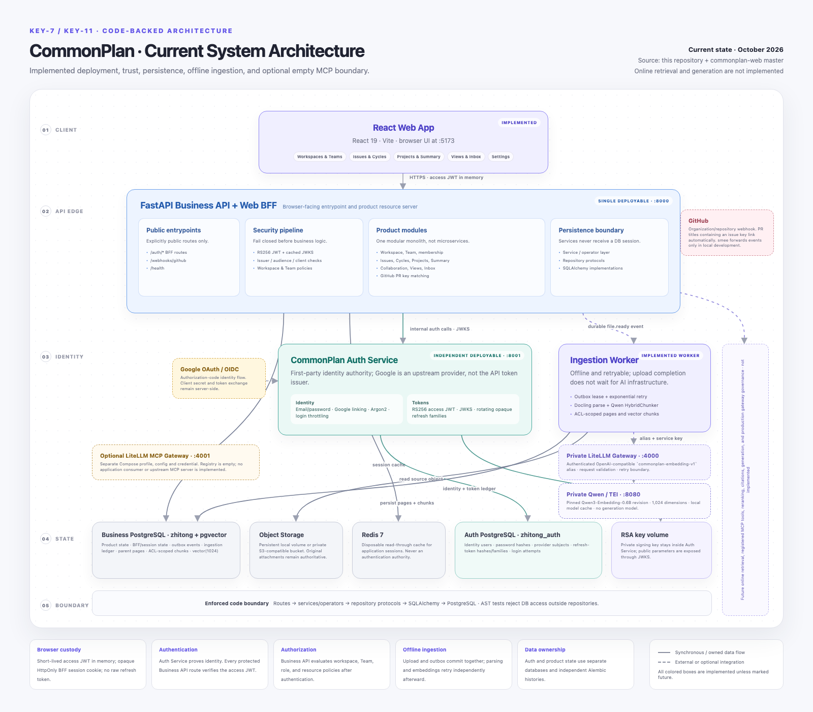

# CommonPlan current system architecture

This is the code-backed current-state architecture after the KEY-11 ingestion foundation. It is
intentionally different from the target design: CommonPlan now has local/S3-compatible attachment
storage, an outbox-driven ingestion worker, Docling parsing, a private LiteLLM Gateway backed by
Qwen/TEI, and canonical pgvector rows. It still has no online retrieval/answer service, general event
bus, reranker, citation assembler, generation model, or registered MCP tool. An optional empty
LiteLLM MCP gateway profile now makes the future tool boundary independently deployable without
claiming any tool integration is complete.

## Deployable units

| Unit | Runtime responsibility |
| --- | --- |
| React Web App | Browser UI. Keeps the short-lived access token in memory and receives only an opaque HttpOnly BFF session cookie. |
| Business API + Web BFF | One FastAPI deployable on port 8000. Owns `/auth/*` browser mediation, all protected product APIs, resource authorization, and the GitHub webhook. |
| Auth Service | Independent FastAPI deployable on port 8001. Owns credentials, Google identity linking, access-token signing, JWKS, refresh rotation, and login throttling. |
| Ingestion Worker | Separate worker image/process. Claims attachment outbox events with leases and retries, reads source objects, runs Docling and HybridChunker, calls the embedding runtime, and persists pages/chunks. |
| LiteLLM Gateway | Private OpenAI-compatible service on port 4000. Authenticates the worker and maps `commonplan-embedding-v1` to the pinned physical embedding profile. |
| LiteLLM MCP Tool Gateway | Optional Compose profile on port 4001. Separate config and credential; currently an empty registry with no upstream MCP server or application consumer. |
| Qwen/TEI embedding runtime | Private local model service. Serves the pinned `Qwen/Qwen3-Embedding-0.6B` revision and returns normalized 1,024-dimensional vectors. |

## Storage ownership

| Store | Authority |
| --- | --- |
| Business PostgreSQL (`zhitong`) | Product entities, local profile projection, browser auth-session vault, application sessions, GitHub PR/webhook records, durable outbox events, ingestion state, pages, chunks, and canonical `vector(1024)` embeddings. |
| Auth PostgreSQL (`zhitong_auth`) | Identity users, password hashes, external identities, refresh-token hash families, login codes, and login attempts. |
| Redis | Disposable read-through cache for application sessions. PostgreSQL remains the source of truth. |
| RSA key volume | Auth Service signing key material. The private key never crosses the identity boundary. |
| Attachment object storage | Signed persistent local volume in development or private S3-compatible storage in deployment. Original files remain the source for re-ingestion. |
| Model/Docling cache volumes | Persistent local caches for pinned Qwen weights and Docling assets; caches are rebuildable and are not authoritative product data. |

## Trust and request flow

1. React sends login, refresh, logout, and Google-start requests to the BFF routes on port 8000.
2. The BFF calls Auth Service over its confidential internal channel. Raw refresh tokens exist only
   transiently in Auth Service and the BFF; Auth stores a hash and the BFF stores an encrypted copy.
3. React sends its short-lived access JWT directly to protected `/api/v1/*` routes.
4. The global router guard verifies RS256 signature, issuer, audience, client, token type, and time
   claims using Auth Service JWKS.
5. Resource policies then enforce workspace membership, Team membership/role, and resource ownership.
6. Services and optional operators call repository protocols. Only repository implementations access
   SQLAlchemy or PostgreSQL; architecture tests enforce this boundary.
7. Completing an upload writes `file_assets` and a `file.ready` outbox event atomically. The ingestion
   worker later claims that event, reads the authorized source object, parses/chunks it, calls the
   authenticated gateway alias, and writes ACL-scoped page and chunk rows. Upload success never waits
   for model availability.

## External integrations

- Google is an upstream OAuth/OIDC identity provider. CommonPlan Auth Service remains the credential
  issuer used by Business API.
- GitHub sends signed pull-request webhooks to Business API. PR titles are matched against issue keys
  at workspace scope without project-to-repository mapping. `smee` is a local-development transport,
  not a production component.

## Implemented ingestion boundary and remaining RAG seam

The offline ingestion foundation is implemented, but it deliberately stops before search. There is no
vector/lexical search endpoint, query embedding path, ACL-filtered candidate retrieval, reranker,
citation assembler, or answer-generation model. LiteLLM is implemented locally for the embedding
path; production gateway PostgreSQL/virtual keys, budgets, and multi-replica governance remain a
deployment follow-up. Any future diagram must continue to distinguish implemented ingestion from
proposed online retrieval and generation.

The optional `tool-gateway` is scaffolding only. It proves that the MCP security plane can run as a
separate deployment, but it does not yet hold user OAuth tokens, expose application-approved tools,
or receive traffic from an Agent/AI service.

The editable visual source is
[`commonplan-current-architecture.html`](commonplan-current-architecture.html). Detailed auth and
request sequences remain in [`../system-architecture.md`](../system-architecture.md).

For the recommended deployment, independent BFF, and staged RAG direction, see the
[target full-system architecture](commonplan-target-architecture.md).
