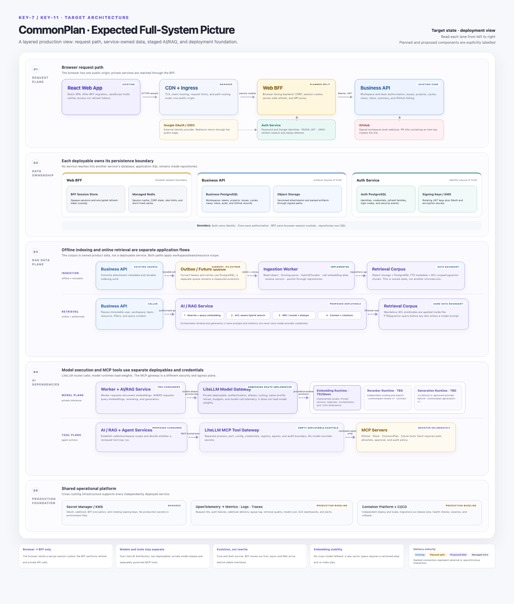

# CommonPlan target full-system architecture



This diagram is the expected production direction, not a claim about today's deployment. Each box is
tagged by delivery maturity: **Existing**, **Planned split**, **Proposed RAG**, or **Managed**.

## Recommended target decisions

### 1. Make the BFF a real independent boundary

The browser should call only the Web BFF for dynamic traffic. The BFF owns secure cookies, CSRF,
server-side refresh, and calls private Business/Auth APIs using access tokens. This removes access-token
visibility from React and resolves the current half-BFF topology where `/auth/*` uses the BFF but
business requests go directly from React to Business API.

The BFF session vault should move out of the Business API's schema into a BFF-owned schema or database.
Redis can accelerate session lookup, but the encrypted durable record should remain recoverable if
Redis is lost.

### 2. Keep Auth and product authorization separate

Auth Service continues to own identities, credentials, Google linking, access-token signing, refresh
families, and security events. Business API remains the resource server and resolves current workspace,
Team, role, and resource policy from product state. Frequently changing permissions should not be
embedded in long-lived identity tokens.

### 3. Deploy the current modular core before splitting domain services

Business API remains one deployable modular monolith. Workspace, Team, issue, cycle, project, summary,
collaboration, view, inbox, and GitHub modules do not need separate services until scaling or ownership
data proves that boundary is valuable.

### 4. Add an async foundation only when RAG ingestion needs it

The target needs durable background jobs for attachments, embeddings, retries, notifications, and
scheduled work. The diagram distinguishes today's PostgreSQL outbox from a future queue. Kafka should
not be selected merely because the reference design uses it; a managed queue or the existing leased
outbox may be sufficient at initial load.

### 5. Add RAG with explicit application, data, and model-runtime boundaries

- **Ingestion & Background Workers**: consume durable index jobs; load original objects; parse,
  normalize, chunk, embed, version, and upsert full-text/vector indexes; retry idempotently.
- **AI/RAG Service**: accept an already-authorized user/workspace/team context from Business API;
  rewrite and embed the query; enforce metadata ACL filters during hybrid full-text/vector search;
  fuse results with RRF, rerank and deduplicate; assemble cited context; call the model gateway; and
  return a grounded answer with source references.
- **Private Model Gateway**: local ingestion now calls a separately deployed,
  OpenAI-compatible LiteLLM gateway instead of calling TEI directly. Production still needs the
  database-backed key/budget control plane and highly available deployment described below. Bifrost
  remains a gateway-neutral alternative to validate with the same conformance/load suite. The gateway
  owns provider credentials, stable model
  aliases, retries, routing, budgets and call telemetry. It does not own prompts, ACL decisions,
  retrieval, citations, or model weights. Workers and online retrieval use the same pinned
  `commonplan-embedding-v1` alias, backed only by the exact Qwen revision and 1024-dimensional profile;
  it may never silently fall back to a different embedding model. Generation is a separate alias and
  is called only after authorization-filtered context has been assembled. See the
  [model gateway decision](model-gateway-decision.md).
- **Independent model runtimes**: the embedding runtime is the implemented Qwen/TEI deployable.
  Future reranker and generation runtimes are separate workloads with independent capacity, health,
  and release lifecycles. They sit behind distinct aliases and may use TEI, vLLM, a local runtime, or
  an approved provider as appropriate; LiteLLM routes to them but does not execute their models.
- **MCP Tool Gateway**: use LiteLLM's MCP capability as a second logical and deployable gateway, not
  as an extra route inside the model-credential boundary. Agent/AI services use it to discover and
  invoke reviewed MCP tools, resources and prompts. Every upstream server needs explicit OAuth or
  service credentials, workspace/user scope propagation, tool allowlists, approval policy, audit and
  egress controls. The repository provides an optional empty local deployment; no upstream tool is
  considered implemented merely because the gateway can start.

The initial vector index can use `pgvector` alongside product metadata in Business PostgreSQL. Original
attachments and parsing artifacts belong in object storage. A separate vector database should be
introduced only after measured scale or retrieval requirements justify it.

The **Retrieval Corpus** in the visual is a data boundary—object storage, PostgreSQL full-text data,
ACL metadata, and pgvector chunks—not an independently deployed microservice. Ingestion Worker writes
it through repositories and AI/RAG Service reads it with mandatory authorization predicates.

Current delivery status is narrower than this target: object storage, parent pages, ACL-scoped chunks,
canonical pgvector embeddings, and the local LiteLLM-to-TEI embedding path are implemented.
Full-text/vector search indexes, query embedding, authorized candidate retrieval, reranking,
citations, generation, and the production gateway control plane are not. See the staged production
work in the [model gateway decision](model-gateway-decision.md).

Ingestion and online retrieval are intentionally separate paths. A document may be indexed again
without blocking user requests, while every online retrieval must apply workspace/team authorization
before any retrieved text is placed in a model prompt.

### 6. Use one gateway product, with separate model and tool deployables

LiteLLM and Bifrost can both package model routing and MCP aggregation. CommonPlan should reuse one
gateway product and its operational tooling, while deploying two security boundaries:

```text
Ingestion Worker ───────────────┐
                               ├── Model Gateway ── embedding / generation / rerank models
AI/RAG and Agent Services ──────┤
                               └── MCP Tool Gateway ── GitHub / Slack / CommonPlan MCP servers
```

Local Compose may run both processes together, on separate ports and with separate credentials.
Production should deploy them independently: the model gateway remains private with provider secrets;
the MCP gateway has its own egress, OAuth callbacks, tool permissions and audit surface. Product data,
retrieval indexes and object storage are still accessed through CommonPlan APIs/repositories—not
through either gateway.

## Public and private routing

| Public path | Destination | Notes |
| --- | --- | --- |
| Static web assets | CDN/static hosting | Immutable builds and SPA fallback. |
| `/app/*`, `/auth/*` | Web BFF | All browser dynamic traffic and session mediation. |
| `/oauth/*` | Auth Service | Only browser redirect/callback surface required by external providers. |
| `/webhooks/github` | Business API webhook receiver | Signature, owner, delivery-id, and event validation before processing. |

Core product APIs, Auth internal token endpoints, AI/RAG, workers, databases, Redis, queues, and object
storage are private service-plane resources. The MCP gateway also remains private unless a reviewed
external MCP client requires its `/mcp` endpoint; that exposure must not also expose the model gateway.

## Staged delivery

1. **Production baseline** — static hosting/CDN, ingress, managed databases/Redis, secret manager,
   migrations as release jobs, health checks, backups, and OpenTelemetry.
2. **BFF separation** — extract current auth/BFF modules, proxy all browser business calls, move the
   encrypted browser-session vault, and stop returning access tokens to JavaScript.
3. **Async and attachment foundation** — object storage, job/event abstraction, idempotent workers,
   retry/dead-letter behavior, and attachment status tracking.
4. **RAG platform** — full-text + vector indexing, ingestion workers, AI/RAG service, model gateway,
   MCP tool gateway, evaluation data, feedback, security filters, and cost/latency observability.

The editable visual source is
[`commonplan-target-architecture.html`](commonplan-target-architecture.html). Compare it with the
[current-state architecture](commonplan-current-architecture.md) to see which boundaries are already
real and which require implementation.
